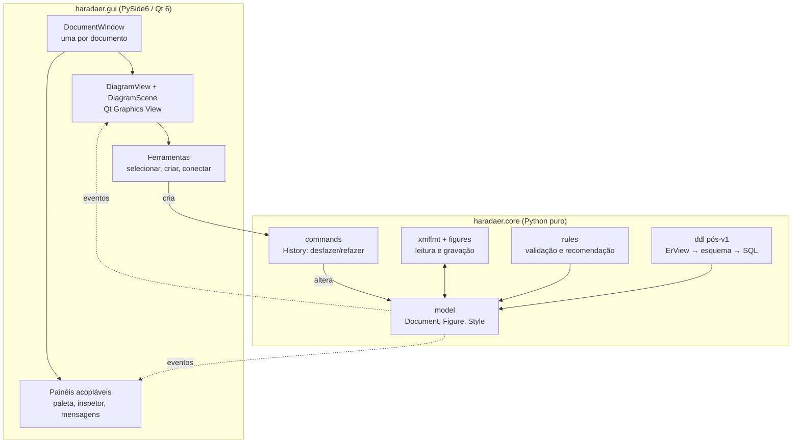
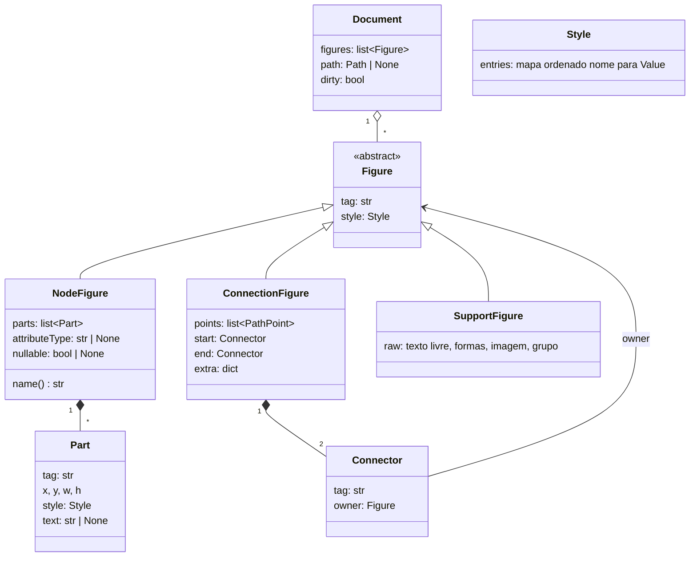
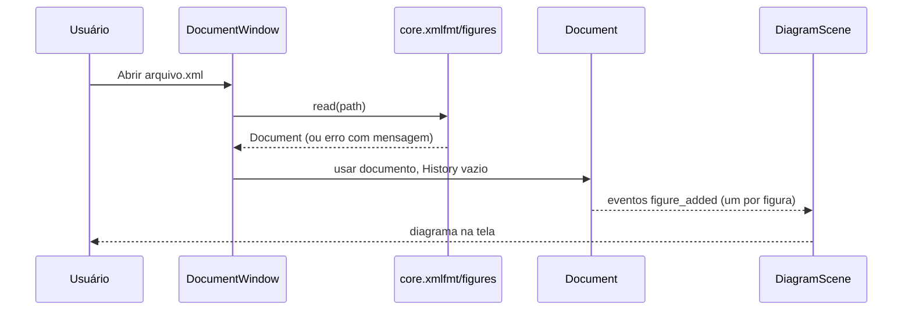
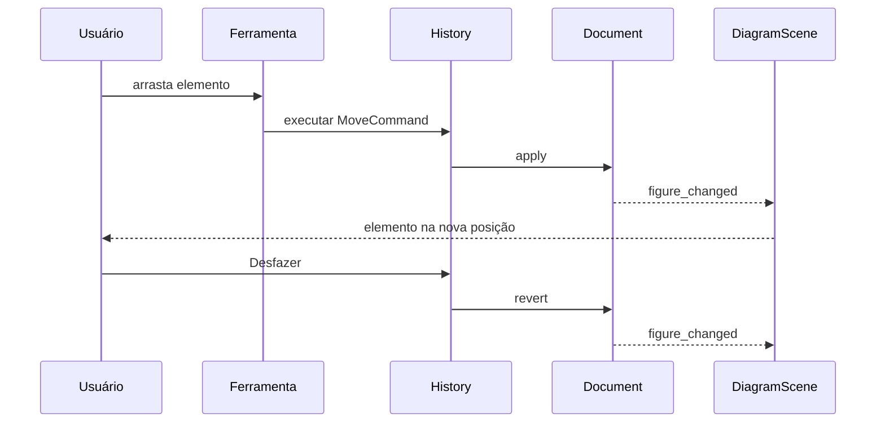

# HaradaER — Arquitetura e Design

Versão 0.7 · 2026-10-19 · Rascunho

Este documento descreve **como** o HaradaER será construído para cumprir `REQUISITOS.md`. Cada decisão aponta o requisito que a motiva. O autor aceitou todas as recomendações das decisões D-01 a D-10 (seção 9). Pontos que dependem dos resultados de `INVESTIGACOES.md` estão sinalizados no texto.

## 1. Princípios

1. **O arquivo manda (RNF-01, RF-12).** O modelo em memória é fiel ao `.xml` do TerraER, não uma abstração ER que depois "volta" para XML. O que se lê é o que se grava.
2. **Núcleo sem tela (RNF-08, RNF-12).** Modelo, leitura/escrita, validação e recomendação (e o DDL, quando entrar) não importam Qt. Tudo isso é testável sem display.
3. **Dados em tabela, não em `if`.** Tags do formato, regras de validação e estilos padrão são tabelas, validadas contra amostras reais do TerraER.
4. **Fluxo de dados em um sentido.** Entrada do usuário → comando → modelo → eventos → tela. A tela nunca altera o modelo diretamente.
5. **Desenho é só visão.** Zoom e rolagem pertencem à visão e não são gravados no arquivo.

## 2. Camadas



Regra de dependência: `gui` importa `core`; `core` **nunca** importa `gui` nem `PySide6`. Um teste automático falha se algum módulo de `core` importar Qt.

## 3. Estrutura de pastas

```
HaradaER/
├── pyproject.toml
├── src/haradaer/
│   ├── core/
│   │   ├── errors.py     # ArquivoInvalidoError
│   │   ├── io.py         # load/save/loads/dumps (salvar com arquivo temporário)
│   │   ├── model/        # Element (árvore com identidade), Document
│   │   ├── xmlfmt/       # reader, writer, escape, numbers (formato exato do TerraER)
│   │   ├── figures/      # tags (tabelas), types (NodeFigure...), validation
│   │   ├── commands/     # Command, History e os comandos de edição
│   │   ├── rules/        # matriz de validação, recomendação de conexão
│   │   ├── ddl/          # (pós-v1) ErView, esquema relacional, gerador SQL
│   │   └── geometry.py   # pontos, retângulos, conectores (interseção com a borda)
│   ├── gui/
│   │   ├── app.py        # QApplication, lista de janelas, arquivos recentes
│   │   ├── window.py     # DocumentWindow
│   │   ├── scene/        # DiagramScene e itens gráficos por tipo de figura
│   │   ├── view.py       # DiagramView: zoom, rolagem, gestos
│   │   ├── tools/        # selecionar, criar nó, conectar, editar texto
│   │   ├── docks/        # paleta, inspetor de objetos, mensagens
│   │   └── i18n/         # catálogos pt e en
│   └── __main__.py       # python -m haradaer
├── tests/
│   ├── core/             # sem tela
│   ├── gui/              # pytest-qt, modo offscreen
│   └── fixtures/         # cópias dos golden files e da matriz de validação
└── docs/
```

## 4. Núcleo

### 4.1 Modelo do documento

O documento é uma **lista ordenada de figuras** (a ordem é o empilhamento), como no arquivo.



Pontos de design:

- **`NodeFigure` cobre os 13 elementos da seção 3.1 de `REQUISITOS.md`.** A diferença entre `ent` e `entfraca` está na tag e no estilo das partes (borda dupla), não em classes diferentes. Uma tabela `ElementKind` lista, por tag, as partes que o elemento tem ao ser criado e o estilo padrão (QA-05).
- **`Style` é um mapa ordenado de nome → `Value`.** `Value` é um tipo com variantes `Str`, `Int`, `Long`, `Float`, `Double`, `Bool`, `Color`, `IntArray`, `FloatArray`, `DoubleArray`, `Font` e `Enum(tipo, nome)`, as mesmas que o TerraER grava. Estilos que o HaradaER não entende são mantidos como estão (RF-12). A ordem é guardada para facilitar comparação, mas **não** é significativa (RNF-04).
- **`SupportFigure`** guarda figuras que o HaradaER não edita por ser ER (RF-12): lê, mostra e regrava sem mudar nada.
- **Identificadores do arquivo (`id="3a"`) não vivem no modelo.** Ids são recalculados na gravação (seção 4.2). Referências são feitas por identidade de objeto (`Connector.owner`).
- **Visão ER derivada.** Validação (e o DDL, no futuro) precisam saber "quais atributos pertencem a qual entidade". Isso é calculado a partir das conexões `lcaf` por uma função `ErView(document)`, sem ser gravado.

#### Estado do modelo no M1

O M1 implementou o modelo de forma mais simples do que o diagrama acima, e isso vale até o M3/M4:

- **`Element`** é a árvore do arquivo, com identidade: o mesmo objeto aparece em vários lugares (a referência `ref` é trocada pelo próprio elemento lido). Guarda tag, atributos como texto (na ordem do arquivo), filhos e texto.
- **`NodeFigure`, `ConnectionFigure` e `SupportFigure`** são subclasses de `Element` com acessores que só leem: `name`, `attribute_type`, `nullable`, `sql`, `parts`, `points`, `start`, `end`, `generalization_label`.
- `Style`, `Value`, `Part` e `Connector` tipados **ainda não existem**. Entram como visões sobre `Element` quando a edição precisar (M4). Por isso a leitura e a gravação já são exatas: nada é reinterpretado no caminho.
- Valores numéricos ficam como o texto do arquivo (`"50"`, `"1.0E-5"`); `format_number` serve para escrever valores novos.

### 4.2 Formato de arquivo (`xmlfmt` e `figures`)

Dois níveis, espelhando o TerraER:

| Nível | Responsabilidade |
|---|---|
| `xmlfmt` | Formato genérico: elemento com `id`, referência `ref`, valores tipados (`<string>`, `<double>`, `<color rgba=>`, `<enum type=>`...), escape, números no formato Java. Não conhece figuras ER. |
| `figures` | Tabela `tag → tipo de figura` (a mesma de `DrawFigureFactory`) e, para cada tipo, como ler e gravar seus campos. |

**Leitura**
1. Parse com `xml.parsers.expat` (biblioteca padrão), com entidades externas desligadas e limites de tamanho e profundidade (RNF-10). `DOCTYPE` sem subconjunto interno é aceito e ignorado, como no TerraER; com subconjunto interno é recusado (RNF-15).
2. Constrói uma árvore genérica e resolve `ref` em uma tabela `id → objeto`. Referência a id que ainda não apareceu é erro com mensagem (os nós vêm antes das conexões).
3. A tabela de `figures` converte a árvore em objetos do modelo.
4. Tag desconhecida: **erro claro** (RNF-14), como o TerraER, que recusa o arquivo inteiro. O arquivo não é aberto e nada é alterado. `SupportFigure` guarda as figuras de apoio **conhecidas** (texto, formas, imagem, grupo).

**Gravação**
- Serializador próprio, escrito à mão, **não** `ElementTree`: precisamos controlar ordem de atributos, escape e números.
- Percorre as figuras em ordem, atribui ids sequenciais em hexadecimal minúsculo na ordem de escrita e emite `ref` quando o objeto já foi escrito.
- Regras exatas de escape e de números: `REQUISITOS.md` seção 4.1 (ASCII com `&#xe7;`, `Double.toString` do Java, inteiros sem `.0`).
- Salva em arquivo temporário e renomeia (RNF-11).

**Números no formato Java.** Python imprime `1e-05` e `1.0E-5` é o esperado. Uma função `java_double_str` implementa a regra do `Double.toString` (notação científica abaixo de 10⁻³ e a partir de 10⁷, mantissa com ao menos um dígito decimal). Ela é coberta por testes contra valores reais do TerraER (`amostra-escapes-e-numeros.xml`).

### 4.3 Validação e recomendação (`rules`)

- A matriz da seção 5 de `REQUISITOS.md` vira uma tabela de dados: `(tag da conexão, tag origem, tag destino) → válido`.
- `validate(document) → list[Issue]`, com `Issue(code, figure, details)`. Códigos: `connection.invalid_pair` (par que o tipo não aceita) e `connection.incomplete` (ponta solta). O núcleo devolve **códigos**, não frases; a interface traduz (seção 5.7).
- `recommend_connections(origem, destino)` devolve os tipos de conexão válidos para o par, sem a conexão livre; `recommend_elements(conexao)` devolve os pares (origem, destino) em que o tipo vale. Os dois usam a mesma tabela da validação (`INVESTIGACOES.md` seção 12).
- **Teste de regressão contra o TerraER.** A tabela (`rules/tables.py`) é conferida par a par contra `matriz-validacao.txt`, e cada conexão dos arquivos de referência é conferida contra o que o próprio TerraER pinta de vermelho (`validacao-por-arquivo.txt`, gerado por `harness/ValidaArquivo.java`; JDK só para regenerar).

### 4.4 DDL (`ddl`) — fora da v1

O DDL foi adiado (RF-13). O desenho abaixo fica reservado para quando voltar ao escopo; a pasta `core/ddl/` não é criada na v1.

Pipeline em três passos, para que as regras ainda desconhecidas (QA-04) entrem sem mexer no resto:

```
Document ──ErView──▶ modelo ER (entidades, atributos, relacionamentos)
         ──mapeamento──▶ esquema relacional (Table, Column, Constraint)
         ──gerador──▶ texto SQL
```

- Contrato reservado: `generate_ddl(document) -> str`.
- Os tipos SQL dos atributos já são conhecidos (`CHAR(128)`, `VARCHAR2(128)`, `NUMBER`, `NUMBER(9,2)`, `DATE`), e o TerraER troca espaços do nome por `_`.
- O mapeamento do passo 2 depende da análise de `GenerateTables`. Antes de implementá-lo, tratar a QA-04 como tarefa própria, com amostras geradas pelo TerraER como golden files.

### 4.5 Comandos e desfazer (`commands`)

- `Command` com `apply(document)` e `revert(document)`. `History` mantém duas pilhas.
- Todo comando de edição passa por aqui: adicionar, excluir, mover, redimensionar, alterar texto, alterar tipo/anulabilidade, agrupar, desagrupar, reordenar, conectar, desconectar.
- Comandos que acontecem durante um arrasto são **mesclados** num só, para o desfazer voltar ao ponto de antes do arrasto.
- Implementação própria em Python (e não `QUndoStack`), para o núcleo testar desfazer sem Qt. A interface liga os comandos "Desfazer" e "Refazer" a `History`.
- `Document` emite eventos (`figure_added`, `figure_removed`, `figure_changed`, `reordered`, `dirty_changed`) para quem se inscrever. A interface se inscreve; o núcleo não depende dela.

### 4.6 Medida de texto e estilos padrão

O TerraER ajusta o tamanho do elemento ao texto (QA-01). O núcleo não tem fonte, então define uma interface:

```python
class TextMeasurer(Protocol):
    def size(self, text: str, font: Font) -> tuple[float, float]: ...
```

- A interface gráfica fornece uma implementação com `QFontMetricsF`.
- Os testes usam uma implementação fixa e previsível.
- **Ao ler um arquivo, a geometria gravada é usada como está.** A medida de texto só entra ao criar um elemento ou editar seu nome.
- Estilos padrão por tipo de elemento (QA-05) ficam em `ElementKind`.

### 4.7 Geometria de conexões

Conectores (`rConnector`, `ellipseConnector`, `diamondConnector`, `bezierConnector`) calculam o ponto em que a linha toca a borda da figura (no TerraER, "Chop*Connector"). Isso vive em `geometry.py`, sem Qt, usando formas simples: retângulo, elipse, losango. Os pontos calculados são gravados em `<points>`.

## 5. Interface gráfica

### 5.1 Janelas e processo

- Um processo, um `QApplication`. `App` guarda a lista de `DocumentWindow` (RF-19).
- Cada janela tem seu `Document`, seu `History`, sua cena, sua visão e seus painéis. Nada é compartilhado entre janelas, exceto a lista de arquivos recentes.
- Fechar a última janela encerra o programa. Fechar uma janela modificada pergunta se quer salvar (RF-17).
- Abrir um arquivo já aberto traz a janela existente para a frente.

### 5.2 Cena e itens (Qt Graphics View)

`QGraphicsScene` e `QGraphicsView` dão zoom, rolagem, seleção, ordem de empilhamento e detecção de clique prontos.

| Classe | Papel |
|---|---|
| `DiagramScene` | Mantém um item por figura do modelo e se atualiza pelos eventos de `Document`. |
| `NodeItem` | Desenha as partes (retângulo, elipse, losango, círculo, texto) conforme o estilo. |
| `ConnectionItem` | Desenha a linha (simples ou dupla) pelos pontos, com rótulo `1`/`N`/texto. |
| `SupportItem` | Mostra texto livre, formas e imagem. |
| `Handle` | Alças de redimensionar e de pontos da conexão. |

Quem muda o modelo é sempre uma ferramenta, via comando. O item **não** se move sozinho: ele pede "mover" e a tela só muda quando o evento do modelo chega. Isso evita que visão e modelo divirjam.

### 5.3 Ferramentas

- **Selecionar:** seleção, arrasto, redimensionamento, laço.
- **Criar nó:** uma por tipo de elemento da paleta.
- **Conectar:** escolhe tipo de conexão, origem e destino; mostra em vermelho se for inválido (RF-09) e **permite** criar assim, como o TerraER.
- **Editar texto:** campo flutuante sobre o elemento (RF-18).

### 5.4 Zoom e gestos (RF-15)

Tratados em `DiagramView.viewportEvent`, com base no teste feito em Linux/Wayland (único sistema alvo da v1):

| Entrada | Evento Qt | Ação |
|---|---|---|
| Pinça | `QNativeGestureEvent` tipo `ZoomNativeGesture`, com `value()` | `escala *= 1 + value`, limitada a uma faixa, em torno da posição do cursor |
| Rolagem com dois dedos | `QWheelEvent` com `pixelDelta()` | Rolar a visão |
| Ctrl + rolagem | `QWheelEvent` com Ctrl | Zoom (não exercitado no teste; implementar e testar no M3) |
| Teclado e menu | Atalhos | Zoom in, out, ajustar à janela, 100% |

- `QPinchGesture` **não** é usado: não disparou no Wayland.
- Rotação (que também chega) é ignorada.
- O zoom é a transformação da visão e não altera o modelo.

### 5.5 Painéis

`QDockWidget`s, como no Octave (RNF-09): paleta de elementos, inspetor de objetos (RF-16) e mensagens da verificação (RF-09). Disposição e visibilidade salvas com `QSettings` (`saveState`/`restoreState`).

### 5.6 Exportação e área de transferência (RF-11)

- Imagem: renderiza a cena num `QImage` e grava **PNG e JPG**.
- **SVG** com `QSvgGenerator` (módulo `QtSvg` do PySide6) e **PDF** com `QPdfWriter`, renderizando a mesma cena.
- **GIF fica fora** (decisão D-08): verificado que o Qt não grava GIF.
- Copiar para a área de transferência: coloca a imagem. Copiar e colar de elementos usa um formato interno (QA-13).

### 5.7 Idiomas (RNF-06)

- O núcleo devolve códigos (`connection.invalid`, `model.empty`...) e nunca texto para o usuário.
- A interface traduz com catálogos do Qt (`tr`, arquivos `.ts`) em português e inglês. Português é o padrão.
- Nomes padrão de elementos novos (`Entidade 1`...) também vêm do catálogo; o texto gravado no arquivo é o do usuário (compatível, seção 4.5 de `REQUISITOS.md`).

## 6. Fluxos principais

**Abrir arquivo**


**Editar com desfazer**


**Salvar:** `Document` → `figures` → serializador → arquivo temporário → renomeia. `dirty` volta a falso.

## 7. Estratégia de testes

Mapeada para os critérios de aceitação da seção 7 de `REQUISITOS.md`.

| Critério | Teste | Onde |
|---|---|---|
| 1. Golden files | Ler cada amostra e gravar; comparar de forma semântica (e byte a byte quando o TerraER também regrava igual) | `tests/core`, `pytest`, sem tela |
| 2. Ida e volta pelo TerraER | Gravar modelos do HaradaER e passá-los por `Gen2 read` | Script que chama `java`; só roda se houver JDK |
| 3. Abertura na GUI do TerraER | Lista de verificação manual | Documentada |
| 4. Estrutura | Gerar modelos com todos os tipos e conexões válidas (propriedade/aleatório) e repetir 1 e 2 | `tests/core` |
| Validação | Tabela contra `matriz-validacao.txt`; cada conexão dos arquivos contra `validacao-por-arquivo.txt` | `tests/core` |
| Núcleo sem Qt | Importar todo `core` e verificar que `PySide6` não foi carregado | `tests/core` |
| Interface | Abrir janela offscreen, simular gestos e arrastos | `tests/gui`, `pytest-qt` |
| Números e escape | Valores extremos e caracteres especiais | `tests/core` com `amostra-escapes-e-numeros.xml` |

Os fixtures são cópias dos arquivos em `docs/referencia-terraer/`.

## 8. Dependências

| Dependência | Uso | Obrigatória |
|---|---|---|
| Python | Linguagem: 3.14 (QA-12) | Sim |
| PySide6 | Interface (Qt 6): 6.12 | Sim, só para `gui` |
| `pytest`, `pytest-qt` | Testes | Só desenvolvimento |
| JDK | Regenerar amostras e a matriz de validação; teste de ida e volta | Só desenvolvimento |

O núcleo usa somente a biblioteca padrão.

## 9. Decisões

Estado: **Decidida** = confirmada pelo autor.

| ID | Decisão | Alternativas | Motivo | Estado |
|---|---|---|---|---|
| D-01 | Python, interface em Qt, via PySide6 | PyQt6; Tkinter | Mesmo sistema do Octave, gestos testados, licença LGPL | **Decidida** |
| D-02 | Uma janela por documento | Abas | Igual ao TerraER, mais simples | **Decidida** |
| D-03 | Modelo fiel ao arquivo, com visão ER derivada | Modelo ER abstrato que gera o XML | RNF-01 e RF-12: nada pode se perder | **Decidida** |
| D-04 | Serializador XML próprio | `ElementTree`, `lxml` | Controle de ordem, escape e números | **Decidida** |
| D-05 | Leitura com `expat` da biblioteca padrão, rejeitando DOCTYPE | `lxml`, `defusedxml` | Sem dependência extra; RNF-10 | **Decidida** |
| D-06 | Qt Graphics View para a tela | Pintura manual em `QWidget` | Zoom, seleção e ordem prontos | **Decidida** |
| D-07 | `History` próprio no núcleo | `QUndoStack` | Núcleo sem Qt e testável | **Decidida** |
| D-08 | Exportar PNG e JPG, SVG e PDF com Qt; sem GIF | `Pillow` para GIF | Qt não grava GIF; SVG/PDF não exigem dependência extra | **Decidida** |
| D-09 | Núcleo devolve códigos; a interface traduz | Texto no núcleo | RNF-06 sem acoplar a Qt | **Decidida** |
| D-10 | Tabelas de dados para tags, regras e estilos | Código condicional | Fácil de validar contra o TerraER | **Decidida** |

## 10. Riscos

| Risco | Efeito | Mitigação |
|---|---|---|
| Medida de texto diferente da do Java (QA-01) | Elementos criados no HaradaER aparecem com tamanho diferente no TerraER | Aceitar diferença visual leve; ao ler, nunca recalcular; comparar no teste manual 3 |
| Geometria dos conectores diferente da do TerraER | Linhas encostam em pontos ligeiramente diferentes | O arquivo grava os pontos, então o TerraER mostra o que o HaradaER gravou; só a aparência no HaradaER pode divergir ao reler |
| Regras de DDL desconhecidas (QA-04) | RF-13 não pode ser concluído por dedução | Tarefa de análise antes de implementar; golden files gerados pelo TerraER |
| Números Java diferentes dos de Python | Arquivo diferente, possivelmente rejeitado | `java_double_str` com testes de borda contra o TerraER |
| Gestos fora do Linux/Wayland (QA-11) | RF-15 não verificado em outros sistemas | Fora da v1: só Linux/Wayland; teclado e menu como alternativa; `gui` isola o tratamento de gestos |
| Suporte só a Python 3.14 e PySide6 6.12 | Quem tiver outra versão pode não conseguir instalar ou rodar | Aceito na v1; declarar `requires-python = ">=3.14"` e revisar quando outras versões forem necessárias |
| Formato de arquivo com tag que o TerraER ignora ou rejeita (QA-07) | Perda ou erro ao abrir | Só gravar tags conhecidas (RNF-02) |

## 11. Roteiro de implementação

Cada marco termina com algo que roda e passa em testes.

| Marco | Entrega | Pronto quando |
|---|---|---|
| M0 | Esqueleto: `pyproject.toml` (Python 3.14, PySide6 6.12), pacotes, `pytest`, teste "núcleo sem Qt" | Os testes rodam vazios e passam |
| M1 | **Concluído.** `xmlfmt` e `figures`: ler e gravar as amostras | Critério 1 passa para 8 amostras (ida e volta idêntica byte a byte ao TerraER); 83 testes |
| M2 | **Concluído.** `rules`: validação e recomendação | Tabela confere par a par com o TerraER; 22 conexões dos arquivos de referência conferem; 109 testes |
| M3 | Interface só de leitura: abrir um `.xml` e ver o diagrama, com zoom e gestos | RF-15 funciona no Linux; golden files aparecem corretos |
| M4 | Edição: criar, mover, conectar, editar texto, desfazer, salvar | Critérios 2 e 4 passam; critério 3 manual |
| M5 | Painéis, inspetor, verificação visual, exportação, janelas múltiplas, arquivos recentes | RF-07 a RF-11, RF-16 a RF-19 |
| M6 | DDL (pós-v1) | Retomar com `INVESTIGACOES.md` seção 6 e decidir entre reproduzir o TerraER e gerar SQL válido |

M3 vem antes da edição de propósito: ler e desenhar fielmente os arquivos do TerraER é o teste mais forte de compatibilidade, e já exercita a parte mais arriscada (geometria e estilo).

## 12. Pendências deste documento

- Estilos padrão e tamanhos de criação já levantados (`INVESTIGACOES.md` seção 5); incorporá-los à tabela `ElementKind` no M4.
- Revisar o suporte a outras versões do Python e do PySide6 se um dia for preciso (QA-12).
- Quando o DDL voltar ao escopo, decidir entre reproduzir o TerraER e gerar SQL válido (`INVESTIGACOES.md` seção 6).
