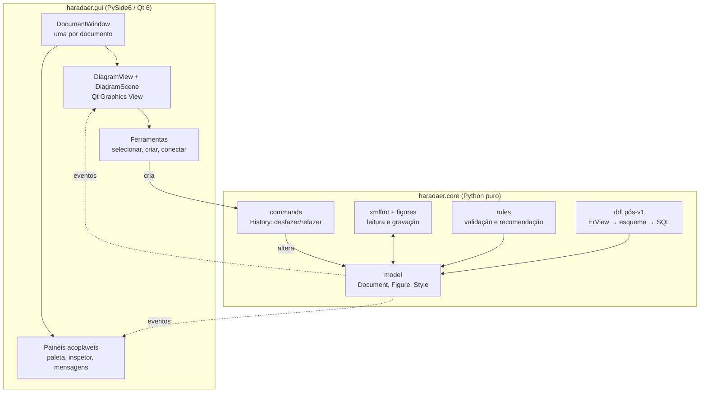
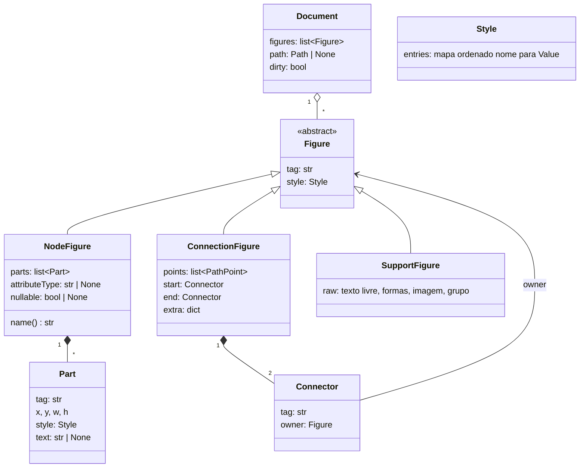
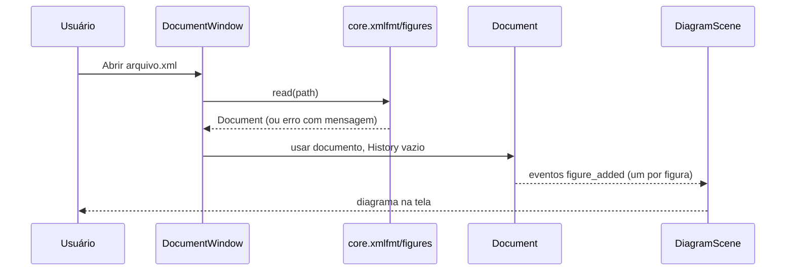
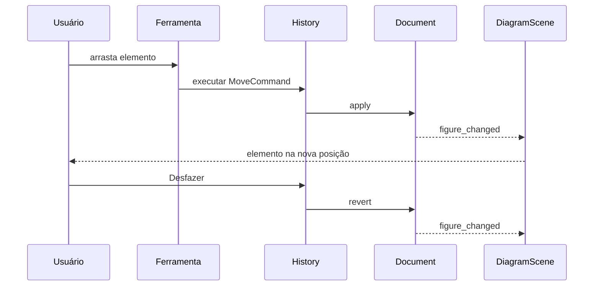

# HaradaER — Arquitetura e Design

Versão 0.9 · 2026-10-20 · Rascunho

Este documento descreve **como** o HaradaER será construído para cumprir `REQUISITOS.md`. Cada decisão aponta o requisito que a motiva. O autor aceitou todas as recomendações das decisões D-01 a D-10 (seção 9) e, em 2026-10-22, a D-11 e as duas exceções à D-09 (seção 5.7), e a D-12 (seção 13). Pontos que dependem dos resultados de `INVESTIGACOES.md` estão sinalizados no texto.

## 1. Princípios

1. **O arquivo manda (RNF-01, RF-12).** O modelo em memória é fiel ao `.xml` do TerraER, não uma abstração ER que depois "volta" para XML. O que se lê é o que se grava.
2. **Núcleo sem tela (RNF-08, RNF-12).** Modelo, leitura/escrita, validação e recomendação (e o DDL, quando entrar) não importam Qt. Tudo isso é testável sem display.
3. **Dados em tabela, não em `if`.** Tags do formato, regras de validação e estilos padrão são tabelas, validadas contra amostras reais do TerraER.
4. **Fluxo de dados em um sentido.** Entrada do usuário → comando → modelo → eventos → tela. A tela nunca altera o modelo diretamente.
5. **Desenho é só visão.** Zoom e rolagem pertencem à visão e não são gravados no arquivo.

## 2. Camadas



Regra de dependência: `gui` importa `core`; `core` **nunca** importa `gui` nem `PySide6`. Um teste automático falha se algum módulo de `core` importar Qt.

## 3. Estrutura de pastas

```
HaradaER/
├── pyproject.toml
├── src/haradaer/
│   ├── core/
│   │   ├── appearance/   # style, ops, describe, metrics: o que desenhar, sem Qt
│   │   ├── errors.py     # ArquivoInvalidoError
│   │   ├── io.py         # load/save/loads/dumps (salvar com arquivo temporário)
│   │   ├── model/        # Element (árvore com identidade), Document
│   │   ├── xmlfmt/       # reader, writer, escape, numbers (formato exato do TerraER)
│   │   ├── figures/      # tags (tabelas), types (NodeFigure...), validation
│   │   ├── commands/     # Command, History, comandos de edição, copiar e colar
│   │   ├── rules/        # matriz de validação, recomendação de conexão, avisos de estrutura
│   │   ├── erview.py     # dono de cada atributo (inspetor)
│   │   └── geometry.py   # pontos, retângulos, conectores (interseção com a borda)
│   ├── gui/
│   │   ├── app.py        # QApplication, lista de janelas, arquivos recentes
│   │   ├── window.py     # DocumentWindow
│   │   ├── editor.py     # Editor: Document + History + medida de texto
│   │   ├── scene/        # DiagramScene e itens gráficos por tipo de figura
│   │   ├── view.py       # DiagramView: zoom, rolagem, gestos, ferramentas
│   │   ├── inline_edit.py # campo de nome sobre o elemento
│   │   ├── inspector.py, properties.py, messages.py # painéis acopláveis
│   │   ├── verification.py # marcas vermelhas e laranja
│   │   ├── tool_strip.py, tool_icons.py, palette.py # barra de ferramentas
│   │   └── export.py, settings.py, theme.py, qt_utils.py
│   ├── i18n/             # idioma: _() e N_(), catálogo en.py (sem Qt)
│   ├── feedback.py       # endereço da issue de Ajuda › Relatar (sem Qt)
│   ├── updates.py        # versão mais recente no GitHub e comparação (sem Qt)
│   └── __main__.py       # python -m haradaer
├── tests/
│   ├── core/             # sem tela
│   └── gui/              # pytest-qt, modo offscreen
└── docs/
```

## 4. Núcleo

### 4.1 Modelo do documento

O documento é uma **lista ordenada de figuras** (a ordem é o empilhamento), como no arquivo.



Pontos de design:

- **`NodeFigure` cobre os 13 elementos da seção 3.1 de `REQUISITOS.md`.** A diferença entre `ent` e `entfraca` está na tag e no estilo das partes (borda dupla), não em classes diferentes. Uma tabela `ElementKind` lista, por tag, as partes que o elemento tem ao ser criado e o estilo padrão (QA-05).
- **`Style` é um mapa ordenado de nome → `Value`.** `Value` é um tipo com variantes `Str`, `Int`, `Long`, `Float`, `Double`, `Bool`, `Color`, `IntArray`, `FloatArray`, `DoubleArray`, `Font` e `Enum(tipo, nome)`, as mesmas que o TerraER grava. Estilos que o HaradaER não entende são mantidos como estão (RF-12). A ordem é guardada para facilitar comparação, mas **não** é significativa (RNF-04).
- **`SupportFigure`** guarda figuras que o HaradaER não edita por ser ER (RF-12): lê, mostra e regrava sem mudar nada.
- **Identificadores do arquivo (`id="3a"`) não vivem no modelo.** Ids são recalculados na gravação (seção 4.2). Referências são feitas por identidade de objeto (`Connector.owner`).
- **Visão ER derivada.** Validação (e o DDL, no futuro) precisam saber "quais atributos pertencem a qual entidade". Isso é calculado a partir das conexões `lcaf` por uma função `ErView(document)`, sem ser gravado.

#### Estado do modelo no M1

O M1 implementou o modelo de forma mais simples do que o diagrama acima, e isso vale até o M3/M4:

- **`Element`** é a árvore do arquivo, com identidade: o mesmo objeto aparece em vários lugares (a referência `ref` é trocada pelo próprio elemento lido). Guarda tag, atributos como texto (na ordem do arquivo), filhos e texto.
- **`NodeFigure`, `ConnectionFigure` e `SupportFigure`** são subclasses de `Element` com acessores que só leem: `name`, `attribute_type`, `nullable`, `sql`, `parts`, `points`, `start`, `end`, `generalization_label`.
- `Style`, `Value`, `Part` e `Connector` tipados **ainda não existem**. Entram como visões sobre `Element` quando a edição precisar (M4). Por isso a leitura e a gravação já são exatas: nada é reinterpretado no caminho.
- Valores numéricos ficam como o texto do arquivo (`"50"`, `"1.0E-5"`); `format_number` serve para escrever valores novos.

### 4.2 Formato de arquivo (`xmlfmt` e `figures`)

Dois níveis, espelhando o TerraER:

| Nível | Responsabilidade |
|---|---|
| `xmlfmt` | Formato genérico: elemento com `id`, referência `ref`, valores tipados (`<string>`, `<double>`, `<color rgba=>`, `<enum type=>`...), escape, números no formato Java. Não conhece figuras ER. |
| `figures` | Tabela `tag → tipo de figura` (a mesma de `DrawFigureFactory`) e, para cada tipo, como ler e gravar seus campos. |

**Leitura**
1. Parse com `xml.parsers.expat` (biblioteca padrão), com entidades externas desligadas e limites de tamanho e profundidade (RNF-10). `DOCTYPE` sem subconjunto interno é aceito e ignorado, como no TerraER; com subconjunto interno é recusado (RNF-15).
2. Constrói uma árvore genérica e resolve `ref` em uma tabela `id → objeto`. Referência a id que ainda não apareceu é erro com mensagem (os nós vêm antes das conexões).
3. A tabela de `figures` converte a árvore em objetos do modelo.
4. Tag desconhecida: **erro claro** (RNF-14), como o TerraER, que recusa o arquivo inteiro. O arquivo não é aberto e nada é alterado. `SupportFigure` guarda as figuras de apoio **conhecidas** (texto, formas, imagem, grupo).

**Gravação**
- Serializador próprio, escrito à mão, **não** `ElementTree`: precisamos controlar ordem de atributos, escape e números.
- Percorre as figuras em ordem, atribui ids sequenciais em hexadecimal minúsculo na ordem de escrita e emite `ref` quando o objeto já foi escrito.
- Regras exatas de escape e de números: `REQUISITOS.md` seção 4.1 (ASCII com `&#xe7;`, `Double.toString` do Java, inteiros sem `.0`).
- Salva em arquivo temporário e renomeia (RNF-11), mantendo as permissões do arquivo substituído (ou as de costume, num arquivo novo).

**Números no formato Java.** Python imprime `1e-05` e `1.0E-5` é o esperado. Uma função `java_double_str` implementa a regra do `Double.toString` (notação científica abaixo de 10⁻³ e a partir de 10⁷, mantissa com ao menos um dígito decimal). Ela é coberta por testes contra valores reais do TerraER (`amostra-escapes-e-numeros.xml`).

### 4.2.1 Aparência (`appearance`)

Entre o arquivo e a tela há uma camada sem Qt que diz **o que desenhar**:

- `Style.of(elemento)` lê os atributos de estilo (`<a>`): cores, espessura, tracejado, fonte, texto.
- `describe_figure(figura, medidor)` devolve operações de desenho (`ShapeOp`, `TextOp`, `PolylineOp`, `ArcOp`, `ImageOp`) na ordem de pintura, aplicando as regras do TerraER (cores fixas por forma, traço duplo, posição dos rótulos, arco da generalização).
- A medida de texto vem de um `TextMeasurer`: a interface usa o `QFontMetricsF`; os testes usam medidas fixas ou as que o TerraER mediu.

A interface só converte as operações em pintura; todo o conhecimento do TerraER fica testável sem tela.

### 4.3 Validação e recomendação (`rules`)

- A matriz da seção 5 de `REQUISITOS.md` vira uma tabela de dados: `(tag da conexão, tag origem, tag destino) → válido`.
- `validate(document) → list[Issue]`, com `Issue(code, figure, details)`. Códigos: `connection.invalid_pair` (par que o tipo não aceita) e `connection.incomplete` (ponta solta). O núcleo devolve **códigos**, não frases; a interface traduz (seção 5.7).
- `recommend_connections(origem, destino)` devolve os tipos de conexão válidos para o par, sem a conexão livre; `recommend_elements(conexao)` devolve os pares (origem, destino) em que o tipo vale. Os dois usam a mesma tabela da validação (`INVESTIGACOES.md` seção 12).
- **Teste de regressão contra o TerraER.** A tabela (`rules/tables.py`) é conferida par a par contra `matriz-validacao.txt`, e cada conexão dos arquivos de referência é conferida contra o que o próprio TerraER pinta de vermelho (`validacao-por-arquivo.txt`, gerado por `harness/ValidaArquivo.java`; JDK só para regenerar).

### 4.4 DDL (`ddl`) — fora da v1

O DDL foi adiado (RF-13). O desenho abaixo fica reservado para quando voltar ao escopo; a pasta `core/ddl/` não é criada na v1.

Pipeline em três passos, para que as regras ainda desconhecidas (QA-04) entrem sem mexer no resto:

```
Document ──ErView──▶ modelo ER (entidades, atributos, relacionamentos)
         ──mapeamento──▶ esquema relacional (Table, Column, Constraint)
         ──gerador──▶ texto SQL
```

- Contrato reservado: `generate_ddl(document) -> str`.
- Os tipos SQL dos atributos já são conhecidos (`CHAR(128)`, `VARCHAR2(128)`, `NUMBER`, `NUMBER(9,2)`, `DATE`), e o TerraER troca espaços do nome por `_`.
- O mapeamento do passo 2 depende da análise de `GenerateTables`. Antes de implementá-lo, tratar a QA-04 como tarefa própria, com amostras geradas pelo TerraER como golden files.

### 4.5 Comandos e desfazer (`commands`)

- `Command` com `apply(document)` e `revert(document)`. `History` mantém duas pilhas.
- Todo comando de edição passa por aqui: adicionar, excluir, mover, redimensionar, alterar texto, alterar tipo/anulabilidade, agrupar, desagrupar, reordenar, conectar, desconectar.
- Comandos que acontecem durante um arrasto são **mesclados** num só, para o desfazer voltar ao ponto de antes do arrasto.
- Implementação própria em Python (e não `QUndoStack`), para o núcleo testar desfazer sem Qt. A interface liga os comandos "Desfazer" e "Refazer" a `History`.
- `Document` emite eventos (`figure_added`, `figure_removed`, `figure_changed`, `reordered`, `dirty_changed`) para quem se inscrever. A interface se inscreve; o núcleo não depende dela.

### 4.6 Medida de texto e estilos padrão

O TerraER ajusta o tamanho do elemento ao texto (QA-01). O núcleo não tem fonte, então define uma interface:

```python
class TextMeasurer(Protocol):
    def size(self, text: str, font: Font) -> tuple[float, float]: ...
```

- A interface gráfica fornece uma implementação com `QFontMetricsF`.
- Os testes usam uma implementação fixa e previsível.
- **Ao ler um arquivo, a geometria gravada é usada como está.** A medida de texto só entra ao criar um elemento ou editar seu nome.
- Estilos padrão por tipo de elemento (QA-05) ficam em `ElementKind`.

### 4.7 Geometria de conexões

Conectores (`rConnector`, `ellipseConnector`, `diamondConnector`, `bezierConnector`) calculam o ponto em que a linha toca a borda da figura (no TerraER, "Chop*Connector"). Isso vive em `geometry.py`, sem Qt, usando formas simples: retângulo, elipse, losango. Os pontos calculados são gravados em `<points>`.

## 5. Interface gráfica

### 5.1 Janelas e processo

- Um processo, um `QApplication`. `App` guarda a lista de `DocumentWindow` (RF-19).
- Cada janela tem seu `Document`, seu `History`, sua cena, sua visão e seus painéis. Nada é compartilhado entre janelas, exceto a lista de arquivos recentes.
- Fechar a última janela encerra o programa. Fechar uma janela modificada pergunta se quer salvar (RF-17).
- Abrir um arquivo já aberto traz a janela existente para a frente.

### 5.2 Cena e itens (Qt Graphics View)

> **Estado no M4.** A cena tem **um `FigureItem` por figura**, que se pinta a partir das operações de desenho do núcleo e sabe onde o clique acerta (forma do elemento, ou faixa em volta da linha). A cena se atualiza pelos eventos do `Document`. As classes específicas (`NodeItem`, `ConnectionItem`) e as alças de redimensionar ficam para o M5. A rolagem é por trackpad, barras ou botão do meio do mouse; arrastar no vazio faz o laço de seleção.

`QGraphicsScene` e `QGraphicsView` dão zoom, rolagem, seleção, ordem de empilhamento e detecção de clique prontos.

| Classe | Papel |
|---|---|
| `DiagramScene` | Mantém um item por figura do modelo e se atualiza pelos eventos de `Document`. |
| `NodeItem` | Desenha as partes (retângulo, elipse, losango, círculo, texto) conforme o estilo. |
| `ConnectionItem` | Desenha a linha (simples ou dupla) pelos pontos, com rótulo `1`/`N`/texto. |
| `SupportItem` | Mostra texto livre, formas e imagem. |
| `Handle` | Alças de redimensionar e de pontos da conexão. |

Quem muda o modelo é sempre uma ferramenta, via comando. O item **não** se move sozinho: ele pede "mover" e a tela só muda quando o evento do modelo chega. Isso evita que visão e modelo divirjam.

### 5.3 Ferramentas

- **Selecionar:** seleção, arrasto, redimensionamento, laço.
- **Criar nó:** uma por tipo de elemento da paleta.
- **Conectar:** escolhe tipo de conexão, origem e destino; mostra em vermelho se for inválido (RF-09) e **permite** criar assim, como o TerraER.
- **Editar texto:** campo flutuante sobre o elemento (RF-18).

### 5.4 Zoom e gestos (RF-15)

Tratados em `DiagramView.viewportEvent`, com base no teste feito em Linux/Wayland (único sistema alvo da v1):

| Entrada | Evento Qt | Ação |
|---|---|---|
| Pinça | `QNativeGestureEvent` tipo `ZoomNativeGesture`, com `value()` | `escala *= 1 + value`, limitada a uma faixa, em torno da posição do cursor |
| Rolagem com dois dedos | `QWheelEvent` com `pixelDelta()` | Rolar a visão |
| Ctrl + rolagem | `QWheelEvent` com Ctrl | Zoom (não exercitado no teste; implementar e testar no M3) |
| Teclado e menu | Atalhos | Zoom in, out, ajustar à janela, 100% |

- `QPinchGesture` **não** é usado: não disparou no Wayland.
- Rotação (que também chega) é ignorada.
- O zoom é a transformação da visão e não altera o modelo.

### 5.5 Painéis

`QDockWidget`s, como no Octave (RNF-09): paleta de elementos, inspetor de objetos (RF-16) e mensagens da verificação (RF-09). Disposição e visibilidade salvas com `QSettings` (`saveState`/`restoreState`).

### 5.6 Exportação e área de transferência (RF-11)

- Imagem: renderiza a cena num `QImage` e grava **PNG e JPG**.
- **SVG** com `QSvgGenerator` (módulo `QtSvg` do PySide6) e **PDF** com `QPdfWriter`, renderizando a mesma cena.
- **GIF fica fora** (decisão D-08): verificado que o Qt não grava GIF.
- Copiar para a área de transferência: coloca a imagem. Copiar e colar de elementos usa um formato interno (QA-13).

### 5.7 Idiomas (RNF-06)

- Catálogo próprio em `haradaer/i18n/` (D-11), sem Qt, como o `Labels_pt`/`Labels_en` do TerraER. O texto em português é a chave, como no gettext: `_("Salvar")` devolve "Salvar" ou "Save". As traduções ficam em `i18n/en.py`; texto sem tradução sai em português.
- `N_("...")` marca um texto de tabela criada ao importar (nomes da faixa, avisos, nomes dos passos de desfazer) para ser traduzido só ao mostrar, com `_()`.
- O idioma é escolhido uma vez, em `gui/app.py` (`choose_language`), antes de criar as janelas: o gravado em Exibir › Idioma ou, na primeira vez, o do sistema (`QLocale`). Trocar no menu grava a escolha e avisa, no idioma novo, que vale ao reabrir. O tradutor `qtbase_pt_BR` dos botões do Qt só é carregado em português.
- A verificação continua devolvendo códigos (D-09), postos em palavras por `gui/verification.py`. O núcleo usa `_()` em dois lugares: as mensagens de `ArquivoInvalidoError`, que vão direto para a tela, e o nome padrão dos elementos novos (`Entidade` ou `Entity`, `característica` ou `characteristic`), que vai para o arquivo como qualquer nome digitado (RNF-01 não muda).
- Termos em inglês: os do TerraER (`Labels_en`), exceto "Associative entity" (o TerraER diz "Entity Relationship") e "Multivalued attribute" (o TerraER diz "Multivalue Attribute"), aceitos pelo autor.
- `tests/test_idioma.py` confere que todo texto marcado tem tradução, que os campos `{...}` e as letras de atalho `&` batem, e procura texto na tela que escapou do `_()`.

### 5.8 Relatar e sugerir (RF-21)

- Menu Ajuda › Relatar um problema e Sugerir uma melhoria. `haradaer/feedback.py` monta o endereço de nova issue do GitHub, com o formulário (`.github/ISSUE_TEMPLATE/bug.yml` ou `melhoria.yml`) e os campos versão, sistema e idioma já preenchidos pelo `id`; `gui/window.py` abre com `QDesktopServices.openUrl`.
- Nada é enviado pelo programa: quem relata vê a página e envia pela própria conta do GitHub. Não há servidor nem chave no programa. O sistema vem de `platform` (e, no Linux, `XDG_SESSION_TYPE`), sem nome de usuário nem caminhos.
- Sem navegador, o endereço aparece numa caixa para copiar.

### 5.9 Aviso de versão nova (RF-22)

- `haradaer/updates.py` lê a versão mais recente em `api.github.com/repos/PedroHarada/HaradaER/releases/latest` (as pré-versões ficam de fora) e a compara com `haradaer.__version__` por número; uma pré-versão vem antes da final de mesmo número. Resposta estranha, erro do GitHub ou falta de rede viram `OSError`.
- `gui/updates.py` (`UpdateChecker`) consulta numa linha de execução à parte e devolve o resultado por sinal do Qt: a janela nunca espera pela rede (limite de 5 s).
- Ao abrir, no máximo uma vez por dia (`atualizacoes/ultima-verificacao`), e só se Ajuda › Verificar ao abrir estiver ligado (padrão). Sem novidade ou sem rede, fica quieto. Ajuda › Verificar atualizações sempre responde.
- Só avisa: **Baixar** abre a página Releases. O programa não baixa nem troca a si mesmo (decisão do autor, 2026-10-22). A única coisa que sai do computador é essa consulta, sem nada pessoal.
- A conexão usa o contexto TLS padrão mais o arquivo de certificados do sistema (`SYSTEM_CA_FILES`): o executável do Linux leva o OpenSSL do Ubuntu, que os procura em `/usr/lib/ssl`, e falhava no Arch (corrigido na 1.1.2).
- Os testes nunca usam a rede: o `tests/conftest.py` troca a consulta por uma falha.

## 6. Fluxos principais

**Abrir arquivo**


**Editar com desfazer**


**Salvar:** `Document` → `figures` → serializador → arquivo temporário → renomeia. `dirty` volta a falso.

## 7. Estratégia de testes

Mapeada para os critérios de aceitação da seção 7 de `REQUISITOS.md`.

| Critério | Teste | Onde |
|---|---|---|
| 1. Golden files | Ler cada amostra e gravar; comparar de forma semântica (e byte a byte quando o TerraER também regrava igual) | `tests/core`, `pytest`, sem tela |
| 2. Ida e volta pelo TerraER | Gravar modelos do HaradaER e passá-los por `Gen2 read` | Script que chama `java`; só roda se houver JDK |
| 3. Abertura na GUI do TerraER | Lista de verificação manual | Documentada |
| 4. Estrutura | Gerar modelos com todos os tipos e conexões válidas (propriedade/aleatório) e repetir 1 e 2 | `tests/core` |
| Validação | Tabela contra `matriz-validacao.txt`; cada conexão dos arquivos contra `validacao-por-arquivo.txt` | `tests/core` |
| Núcleo sem Qt | Importar todo `core` e verificar que `PySide6` não foi carregado | `tests/core` |
| Interface | Abrir janela offscreen, simular gestos e arrastos | `tests/gui`, `pytest-qt` |
| Números e escape | Valores extremos e caracteres especiais | `tests/core` com `amostra-escapes-e-numeros.xml` |

Os fixtures são cópias dos arquivos em `docs/referencia-terraer/`.

## 8. Dependências

| Dependência | Uso | Obrigatória |
|---|---|---|
| Python | Linguagem: 3.14 (QA-12) | Sim |
| PySide6 | Interface (Qt 6): 6.12 | Sim, só para `gui` |
| `pytest`, `pytest-qt` | Testes | Só desenvolvimento |
| JDK | Regenerar amostras e a matriz de validação; teste de ida e volta | Só desenvolvimento |

O núcleo usa somente a biblioteca padrão.

## 9. Decisões

Estado: **Decidida** = confirmada pelo autor.

| ID | Decisão | Alternativas | Motivo | Estado |
|---|---|---|---|---|
| D-01 | Python, interface em Qt, via PySide6 | PyQt6; Tkinter | Mesmo sistema do Octave, gestos testados, licença LGPL | **Decidida** |
| D-02 | Uma janela por documento | Abas | Igual ao TerraER, mais simples | **Decidida** |
| D-03 | Modelo fiel ao arquivo, com visão ER derivada | Modelo ER abstrato que gera o XML | RNF-01 e RF-12: nada pode se perder | **Decidida** |
| D-04 | Serializador XML próprio | `ElementTree`, `lxml` | Controle de ordem, escape e números | **Decidida** |
| D-05 | Leitura com `expat` da biblioteca padrão, rejeitando DOCTYPE | `lxml`, `defusedxml` | Sem dependência extra; RNF-10 | **Decidida** |
| D-06 | Qt Graphics View para a tela | Pintura manual em `QWidget` | Zoom, seleção e ordem prontos | **Decidida** |
| D-07 | `History` próprio no núcleo | `QUndoStack` | Núcleo sem Qt e testável | **Decidida** |
| D-08 | Exportar PNG e JPG, SVG e PDF com Qt; sem GIF | `Pillow` para GIF | Qt não grava GIF; SVG/PDF não exigem dependência extra | **Decidida** |
| D-09 | Núcleo devolve códigos; a interface traduz | Texto no núcleo | RNF-06 sem acoplar a Qt | **Decidida**; exceções aceitas em 2026-10-22: erros ao abrir arquivo e nome padrão dos elementos (seção 5.7) |
| D-10 | Tabelas de dados para tags, regras e estilos | Código condicional | Fácil de validar contra o TerraER | **Decidida** |
| D-11 | Idioma por catálogo próprio, com o texto em português como chave | `tr()` com `.ts`/`.qm` do Qt | Sem passo de compilação; o núcleo usa sem Qt (RNF-08); testável sem tela | **Decidida** (aceita pelo autor em 2026-10-22) |
| D-12 | Versões `x.y.z` pelo efeito para quem usa (seção 13) | Subir o `x` por acúmulo de versões | Critério que dá para conferir; segue o Versionamento Semântico | **Decidida** (aceita pelo autor em 2026-10-22) |

## 10. Riscos

| Risco | Efeito | Mitigação |
|---|---|---|
| Medida de texto diferente da do Java (QA-01) | Elementos criados no HaradaER aparecem com tamanho diferente no TerraER | Aceitar diferença visual leve; ao ler, nunca recalcular; comparar no teste manual 3 |
| Geometria dos conectores diferente da do TerraER | Linhas encostam em pontos ligeiramente diferentes | O arquivo grava os pontos, então o TerraER mostra o que o HaradaER gravou; só a aparência no HaradaER pode divergir ao reler |
| Regras de DDL desconhecidas (QA-04) | RF-13 não pode ser concluído por dedução | Tarefa de análise antes de implementar; golden files gerados pelo TerraER |
| Números Java diferentes dos de Python | Arquivo diferente, possivelmente rejeitado | `java_double_str` com testes de borda contra o TerraER |
| Gestos fora do Linux/Wayland (QA-11) | RF-15 não verificado em outros sistemas | Fora da v1: só Linux/Wayland; teclado e menu como alternativa; `gui` isola o tratamento de gestos |
| Suporte só a Python 3.14 e PySide6 6.12 | Quem tiver outra versão pode não conseguir instalar ou rodar | Aceito na v1; declarar `requires-python = ">=3.14"` e revisar quando outras versões forem necessárias |
| Formato de arquivo com tag que o TerraER ignora ou rejeita (QA-07) | Perda ou erro ao abrir | Só gravar tags conhecidas (RNF-02) |

## 11. Roteiro de implementação

Cada marco termina com algo que roda e passa em testes.

| Marco | Entrega | Pronto quando |
|---|---|---|
| M0 | **Concluído.** Esqueleto: `pyproject.toml` (Python 3.14, PySide6 6.12), pacotes, `pytest`, teste "núcleo sem Qt" | Os testes rodam vazios e passam |
| M1 | **Concluído.** `xmlfmt` e `figures`: ler e gravar as amostras | Critério 1 passa para 8 amostras (ida e volta idêntica byte a byte ao TerraER); 83 testes |
| M2 | **Concluído.** `rules`: validação e recomendação | Tabela confere par a par com o TerraER; 22 conexões dos arquivos de referência conferem; 109 testes |
| M3 | **Concluído.** Interface de leitura: abrir um `.xml` e ver o diagrama, com zoom e gestos | Pinça e rolagem com dois dedos funcionam no Linux/Wayland; as amostras de referência desenham como no TerraER; 167 testes |
| M4 | **Concluído.** Edição: criar, mover, conectar, editar nome, excluir, desfazer/refazer, salvar | 225 testes (166 do núcleo, 58 da interface); o TerraER abre e regrava o arquivo criado sem mudar o modelo (`INVESTIGACOES.md` seção 14) |
| M5a | **Concluído.** Verificação em vermelho com liga/desliga, recomendação de conexão na barra de ferramentas, botões do Qt em português e mensagem clara quando não grava | RF-09, RF-10, RF-17; 239 testes |
| M5b | **Concluído.** Alças de redimensionar, trazer para a frente e enviar para trás, grade com encaixe, alinhar (6 modos), selecionar tudo e do mesmo tipo | RF-03 (redimensionar), RF-07; 261 testes |
| M5c | **Concluído.** Inspetor de objetos (painel com árvore), painel de propriedades (nome, tipo SQL, anulabilidade, tipo de conexão, rótulo), localizar por nome | RF-05, RF-08, RF-16; 286 testes |
| M5d | **Concluído.** Exportar PNG, JPG, SVG e PDF; copiar como imagem; arquivos recentes; disposição da janela lembrada entre sessões | RF-01 (recentes), RF-11, RNF-09; 325 testes |
| M6 | DDL (pós-v1) | Retomar com `INVESTIGACOES.md` seção 6 e decidir entre reproduzir o TerraER e gerar SQL válido |

M3 vem antes da edição de propósito: ler e desenhar fielmente os arquivos do TerraER é o teste mais forte de compatibilidade, e já exercita a parte mais arriscada (geometria e estilo).

## 12. Notas de implementação

O que foi decidido em cada marco, além do que as seções anteriores descrevem.

- No M5c:
  - **Inspetor de objetos** (`gui/inspector.py`): árvore com Entidades, Relacionamentos, Generalizações, Atributos sem dono e Conexões. Cada atributo aparece pendurado no dono, calculado das ligações `lcaf` por `core/erview.py` (atributo composto fica dentro do atributo). A seleção anda nos dois sentidos entre a árvore e o desenho.
  - **Localizar** (Editar › Localizar, Ctrl+F): o campo no alto do inspetor filtra a árvore pelo nome, sem diferenciar maiúsculas nem acentos; Enter seleciona o primeiro elemento achado e o centraliza. A busca considera só elementos, não conexões.
  - **Propriedades** (`gui/properties.py`): nome; tipo SQL e anulabilidade dos atributos com tipo, mostrando o nome do TerraER junto do valor gravado (`INTEGER (NUMBER)`); tipo de conexão; rótulo da generalização. O atributo derivado avisa que não tem tipo. Cada mudança é um comando e pode ser desfeita.
  - **Mudar o tipo de uma conexão** (`change_connection_type_command`) acerta o que depende do tipo, para o arquivo sair igual ao de uma conexão criada já com o novo tipo: rótulo da generalização, blocos de estilo das conexões duplas e a direção atributo → dono em `lcaf`.
  - Os painéis podem ser escondidos pelo menu Exibir.
- No M5d:
  - **Exportar** (Arquivo › Exportar desenho, Ctrl+E; `gui/export.py`): PNG e JPG com o dobro de pixels, SVG e PDF em tamanho real (1 unidade = 1 ponto). Exporta só o modelo, sem seleção, sem as marcas vermelhas da verificação e sem a grade, com fundo branco e margem de 20. Se o nome não tiver extensão, usa a do filtro escolhido. Desenho vazio não exporta.
  - **Copiar como imagem** (Editar, Ctrl+Shift+C): a mesma imagem do PNG vai para a área de transferência.
  - **Recentes** (Arquivo › Abrir recente; `gui/settings.py`): até 10, do mais novo ao mais antigo, compartilhados entre as janelas; entram ao abrir e ao salvar. Um recente que não existe mais some da lista e avisa.
  - **Disposição**: tamanho da janela e posição/visibilidade dos painéis ficam nas configurações do usuário (`~/.config/HaradaER/`) e voltam na próxima janela. Os testes usam uma pasta temporária (`tests/gui/conftest.py`).
  - **Gabaritos protegidos**: `tests/test_referencias_intactas.py` confere o SHA-256 dos arquivos gravados pelo TerraER. No teste manual do M5c a `amostra-basica.xml` foi salva por cima e entrou no commit; foi restaurada no M5d.
- O RF-19 (uma janela por documento) já está pronto: `WindowManager` em `gui/app.py`.
- No M5a, a verificação começa **ligada** em cada janela (no TerraER começa desligada) e não é gravada no arquivo. A recomendação aparece na barra: com dois elementos selecionados, os tipos aceitos ficam em negrito e clicar num deles liga os dois.
- No M5b:
  - **Redimensionar** usa a regra do TerraER ao renomear (QA-01): a forma não fica menor que o texto + 20 de largura nem que a altura do texto, e o texto fica centralizado. O círculo da generalização continua redondo, e o losango interno da entidade associativa acompanha com 2 de recuo. O comportamento das alças do TerraER não foi medido; o arquivo gravado continua válido, porque a geometria é a da forma.
  - **Grade:** um interruptor só (Exibir › Grade), de 10 unidades, que começa desligado e não vai para o arquivo. Com ela ligada, criar encaixa o centro do elemento, mover encaixa o canto do elemento sob o mouse e redimensionar encaixa a borda arrastada.
  - **Alinhar** usa a caixa da seleção, como o `AlignAction` do JHotDraw. As conexões são religadas uma vez só, com a posição final de todos os elementos.
  - **Empilhamento:** trazer para a frente e enviar para trás mantêm a ordem entre as figuras escolhidas. Uma conexão enviada para trás dos seus elementos é gravada com o dono por dentro do `Owner`, como no TerraER.
- Depois do M5d (teste geral da v1): conexões repetidas entre o mesmo par saem com duas dobras, sem cruzar e alternando de lado (`parallel_bends` em `core/geometry.py`); entidade → relacionamento é gravado ao contrário e as conexões "N" são numeradas N, M, P... como no TerraER; linhas com dobras são religadas mirando a dobra (`route_ends`). Detalhes em `INVESTIGACOES.md`, seção 15.
- Edição da linha das conexões: adicionar, mover e remover vértices, endireitar e reconectar uma ponta (`add_bend_command`, `move_bend_command`, `remove_bend_command`, `straighten_command`, `reconnect_command`; alças em `DiagramView.connection_handles`). Detalhes em `INVESTIGACOES.md`, seção 16.
- Ao mover (`move_command`), as dobras das conexões ficam paradas, como no TerraER, exceto quando as duas pontas andam juntas ou quando a própria conexão está na seleção arrastada: aí a linha inteira acompanha (decisão do autor, 2026-10-22, versão 1.1.1).
- Barra de ferramentas (pedido do autor depois da v1): uma faixa no alto com todas as ferramentas, com ícone e nome curto embaixo (nome completo na dica). O que não cabe se alcança rolando a faixa (dois dedos, roda do mouse ou as setas das pontas, que só aparecem quando falta espaço), em vez do menu "»" do `QToolBar` (`gui/tool_strip.py`). A faixa fica numa barra fixa com nome próprio, que a disposição salva não consegue mover nem quebrar em duas linhas. Os ícones são desenhados pelas mesmas regras do diagrama (`gui/tool_icons.py`), a partir de um elemento ou de uma conexão de verdade, reduzidos; nada vem das imagens do TerraER (RNF-13). Os painéis da direita têm largura mínima de 230.
- Temas claro, escuro e do sistema (`gui/theme.py`, Exibir › Tema), lembrados entre sessões. O tema do sistema vem do qt6ct: o Qt do PySide6 não tem o plugin do qt6ct que o sistema usa (`QT_QPA_PLATFORMTHEME=qt6ct` não faz efeito nele), então o HaradaER lê `~/.config/qt6ct/qt6ct.conf` e o arquivo de cores apontado por `color_scheme_path` (uma cor por papel, na ordem de `QPalette.ColorRole`), e vigia esses arquivos para acompanhar a troca de tema. Do tema do sistema saem o fundo do diagrama (Base), a tinta das linhas (Text) e o destaque da seleção (Highlight). Claro e escuro são paletas próprias sobre o Fusion. No escuro, as formas mantêm as cores do TerraER (com texto preto dentro) e só o que fica direto sobre o fundo clareia: linhas e rótulos das conexões, linhas livres e texto solto. O arquivo não muda, e a exportação sai sempre no tema claro.

Pendências (depois da v1):

- Revisar o suporte a outras versões do Python e do PySide6 se um dia for preciso (QA-12).
- Quando o DDL voltar ao escopo, decidir entre reproduzir o TerraER e gerar SQL válido (`INVESTIGACOES.md` seção 6).

## 13. Numeração das versões (D-12)

As versões seguem `x.y.z`, no espírito do Versionamento Semântico. O que decide o número é o efeito para quem usa, não o tamanho da mudança. Cada versão fica registrada em `CHANGELOG.md`.

- **`z` (correção):** o programa faz o mesmo que antes, só que melhor. Bugs, ajustes visuais, desempenho, textos e traduções, empacotamento e dependências sem mudança visível.
- **`y` (funcionalidade):** o usuário passa a conseguir algo que não conseguia, e nada do que já existia quebra. O `z` volta a 0.
- **`x` (quebra):** algo que já funcionava deixa de funcionar como antes. O `y` e o `z` voltam a 0. O autor também pode subir o `x` para marcar um marco, mas como exceção anunciada.

Regras:

- Na dúvida, ou com mudanças de mais de um tipo na mesma versão, vale o número mais alto.
- Pré-versões levam hífen (`1.1.0-rc1`) e saem como pré-lançamento.
- Uma versão publicada não muda: se sair com erro, a correção é a versão seguinte (a 1.0.0 virou a 1.0.1).
- Mudança só na documentação do repositório, que não altera os pacotes, não gera versão; entra na próxima.
- Uma funcionalidade nova pode sair como versão **em avaliação**: o `CHANGELOG` diz isso, e as melhorias e alterações que o uso pedir saem como `z` da mesma linha, mesmo que mudem o comportamento dela. Foi o caso da Edição rápida e da troca de tipo na 1.2.0 (decisão do autor, 2026-10-25): ajustes nas 1.2.x. Uma versão só vira a `y` nova quando a branch dela entra na `main`; a branch `atalhos-novos` virou a 1.2.0 ao entrar na `main`.

Exemplos de `z`:

| Mudança | Por quê |
|---|---|
| Tradução para o inglês errada ou faltando | Texto, não funcionalidade |
| Aviso "entidade sem atributo-chave" onde não devia | Bug numa regra que já existe |
| Seta da conexão torta ao mover um elemento | Bug de desenho |
| Abrir um modelo grande mais rápido | Desempenho, mesmo comportamento |
| Cor de um ícone ajustada no tema escuro | Ajuste visual |
| `instalar.sh` que não criava o atalho em alguma distribuição | Empacotamento |
| App do macOS com a versão certa (1.0.1) | Empacotamento |
| PySide6 atualizado sem mudança visível | Dependência |
| `.xml` do TerraER com caractere raro que não abria | Bug de leitura; o formato não muda |

Exemplos de `y`:

| Mudança | Por quê |
|---|---|
| Paleta à esquerda como opção (RNF-09) | Opção nova |
| Gerar DDL (RF-13) | Funcionalidade nova |
| Editar o SQL do derivado ou o Modo de Edição Rápida (RF-20) | Funcionalidade nova |
| Um terceiro idioma | Opção nova |
| Atalho novo, sem mudar os existentes | Recurso novo |
| Exportar para SVG, além de PNG e PDF | Saída nova |
| Regra nova nos avisos de estrutura | Verificação nova, desligável em Exibir |
| Funcionar no Mac com chip Intel | Mais sistemas suportados |
| Opções novas na linha de comando | Recurso novo |
| Ler um formato novo, mantendo o `.xml` como padrão | Entrada nova, sem quebrar a antiga |

Exemplos de `x`:

| Mudança | Por quê |
|---|---|
| Salvar por padrão num formato que o TerraER 3.14 não abre | Quebra a compatibilidade (RNF-01) |
| Retirar uma função, como exportar em PDF | O usuário perde algo |
| Trocar o sentido de um atalho (o Delete apagar em cascata) | Hábito quebrado |
| Deixar de suportar o Windows 10 ou o macOS 14 | Quem usava fica de fora |
| Guardar as preferências em outro lugar sem migrar as antigas | O usuário perde as configurações |
| Arquivos antigos passam a aparecer diferentes ao abrir | O desenho salvo muda |

Casos de fronteira:

- Correção que muda o arquivo salvo: `z` se a versão anterior e o TerraER ainda o abrem; `x` se não.
- Funcionalidade nova e bug corrigido na mesma versão: `y`.
- Mudar um padrão (o tema inicial, por exemplo) mantendo o antigo como opção: `y`.
- Funcionalidade nova ainda em teste: `1.1.0-rc1`; a `1.1.0` sai quando confirmada.

## 14. Como a edição está montada (M4)

Núcleo (sem Qt):

- `core/geometry.py`: caixa do elemento (a forma principal) e pontos das conexões. A linha vai do centro de um elemento ao do outro e termina na borda da caixa, como o `rConnector` do TerraER.
- `core/figures/factory.py`: `ElementKind` (nome padrão, forma, tamanho, estilo, tipo SQL padrão) e `create_node`/`create_connection`, que montam a mesma estrutura que o TerraER grava.
- `core/commands/history.py`: `Command`, `Composite` e `History` (duas pilhas, "modificado desde a última gravação", grupos: `begin_macro`/`end_macro`/`cancel_macro`). Um arrasto de 100 movimentos é um passo de desfazer.
- `core/commands/edit.py`: comandos elementares (`SetAttr`, `SetChildren`, `SetText`, `InsertFigure`, `RemoveFigure`) e as operações montadas com eles: criar, conectar, excluir (leva as conexões ligadas), mover (religa as conexões), renomear (a forma cresce e nunca encolhe, o texto centraliza), tipo SQL, anulabilidade e rótulo da generalização.
- `Document` emite `added`, `removed` e `changed`; é assim que a cena se mantém em dia.

Interface:

- `gui/editor.py`: `Editor` junta `Document`, `History` e a medida de texto do Qt. A tela só chama o editor.
- `gui/view.py`: ferramentas `Selecionar`, `Criar` e `Conectar`; arrastar elementos; campo de nome flutuante (`gui/inline_edit.py`); durante um arrasto a área da cena fica parada para o desenho não pular sob o mouse.
- `gui/window.py`: menus Arquivo (Novo, Abrir, Salvar, Salvar como, Fechar), Editar (Desfazer, Refazer, Excluir), barra de ferramentas e a pergunta ao fechar com alterações.

Regras que seguem o TerraER: uma conexão pode ser criada entre qualquer par, mesmo inválido (a verificação visual vem no M5); `lcaf` é gravada do atributo para o dono, qualquer que seja a direção do arrasto; os tipos SQL gravados são só os cinco que o TerraER sabe reler.
